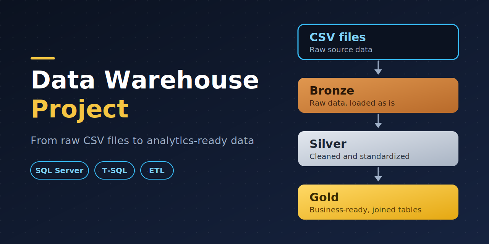

# Data Warehouse Project (SQL Server)

A SQL Server data warehouse that takes raw data from CSV files, cleans and standardizes it, and turns it into business-ready tables for analytics and reporting. The project is built on a three-layer **Bronze, Silver, Gold** architecture.



---

## Project Overview

Raw business data usually arrives in messy files: duplicate records, extra spaces, inconsistent codes, and wrong or missing values. This project solves that by moving the data through three layers, where each layer has one clear job.

| Layer | Purpose | State of the data |
|---|---|---|
| **Bronze** | Store the data exactly as it arrived | Raw, unchanged |
| **Silver** | Clean and standardize the data | Cleaned, consistent |
| **Gold** | Combine related tables for business use | Integrated, analytics-ready |

---

## Architecture

```
  CSV files (source data)
          |
          |  load as-is
          v
  +-----------------+
  |     BRONZE      |   raw tables, no changes
  +-----------------+
          |
          |  clean + standardize
          v
  +-----------------+
  |     SILVER      |   duplicates removed, spaces trimmed, values fixed
  +-----------------+
          |
          |  join + model for business use
          v
  +-----------------+
  |      GOLD       |   merged, business-ready tables / views
  +-----------------+
          |
          v
  Analytics, reporting, dashboards
```

---

## Layer Details

### Bronze Layer: raw data

- Tables are created first, then the CSV data is loaded into them **exactly as it appears in the source files**.
- No cleaning or transformation happens here.
- Keeping the raw copy means the original data can always be checked or reprocessed if something goes wrong later.

### Silver Layer: cleaned data

The Bronze data is cleaned and standardized so it can be trusted. Main steps:

| Problem in raw data | How it is fixed |
|---|---|
| Duplicate records | Removed with `ROW_NUMBER()` (keep the latest or best row per key) |
| Extra spaces around text | Removed with `TRIM` |
| Inconsistent codes (for example `M`, `S`, `R`, `T`) | Converted to readable values with `CASE WHEN` (for example `Married`, `Road`, `Touring`) |
| Inconsistent casing | Standardized with `UPPER` before matching |
| Empty or `NULL` values | Replaced with a default such as `n/a`, using `CASE` and `COALESCE` |
| Negative or wrong numeric values | Corrected with `ABS` and recalculated where needed (for example `sales = price x quantity`) |

> Add or remove rows in this table so it matches the cleaning rules in your own scripts.

### Gold Layer: business-ready data

- Related Silver tables are **joined and merged** into tables (or views) built for reporting.
- This layer is what analysts and reporting tools query, so they never need to touch the raw or intermediate data.
- Business-friendly names and combined information (for example customer, product, and sales details together) make the data easy to use.

---

## ETL Process

The pipeline follows an **Extract, Load, Transform** flow:

1. **Extract:** read the source CSV files.
2. **Load:** load the data into Bronze with SQL Server.
3. **Transform:** clean it into Silver, then model it into Gold with SQL.

---

## Tech Stack

- **Database:** Microsoft SQL Server
- **Tool:** SQL Server Management Studio (SSMS)
- **Language:** T-SQL
- **Source format:** CSV files
- **Version control:** Git and GitHub

---

## Repository Structure

> Adjust this to match your actual folders and file names.

```
data-warehouse-project/
├── README.md
├── datasets/              # source CSV files
├── docs/                  # architecture diagram, notes
├── scripts/
│   ├── init_database.sql  # creates the database and the bronze, silver, gold schemas
│   ├── bronze/            # create tables and load raw data
│   ├── silver/            # cleaning and transformation
│   └── gold/              # business-ready tables / views
└── tests/                 # data quality checks
```

---

## How to Run

1. Install SQL Server and SSMS.
2. Run `scripts/init_database.sql` to create the database and the three schemas.
   - **Warning:** this script drops the database if it already exists. Do not run it on a server that holds data you need.
3. Run the Bronze scripts to create the tables and load the CSV data. Update the file paths inside the scripts to the location of the CSV files on your machine.
4. Run the Silver scripts to clean the data.
5. Run the Gold scripts to build the final tables or views.
6. Query the Gold layer, for example:
   ```sql
   SELECT * FROM gold.<your_view_or_table>;
   ```

---

## Key Concepts Practiced

- Layered data warehouse design (Bronze, Silver, Gold)
- Data cleaning and standardization in T-SQL
- Duplicate removal with window functions
- `CASE WHEN`, `COALESCE`, `TRIM`, `UPPER`, `ABS`
- Joining and integrating data from multiple tables
- Views and stored procedures
- Repeatable, script-based database setup

---

## Future Improvements

- Add incremental loading instead of full reloads
- Add automated data quality checks
- Build a Power BI or Tableau dashboard on top of the Gold layer
- Schedule the pipeline to run automatically

---

## Author

Uday Singh Rana
https://www.linkedin.com/in/uday-singh-rana-8a638242b/

## Acknowledgment
This project is heavily inspired by the project of Baraa Khatib Salkini from his SQL course.
